# Activity Diagram A.I-Check

Dokumen ini menerjemahkan use case yang tersedia pada implementasi situs saat ini menjadi activity diagram terpisah per use case dan dikelompokkan berdasarkan aktor. Diagram menggunakan Mermaid `flowchart` dengan node awal/akhir, aktivitas, dan keputusan untuk merepresentasikan alur aktivitas UML.

## Aktor dan cakupan

- **Pengunjung**: belum masuk ke akun; dapat mengakses halaman publik, mendaftar, dan masuk.
- **Pengguna terdaftar**: dapat menjalankan fitur yang memerlukan autentikasi, termasuk analisis gambar, riwayat, dan profil.
- **Admin**: pengguna dengan peran `admin`. Admin juga dapat menggunakan use case pengguna terdaftar. Pada versi saat ini, area admin hanya menampilkan informasi; belum tersedia alat pengelolaan.
- **Layanan model AI lokal**: sistem eksternal terhadap alur web yang menerima gambar untuk menghasilkan prediksi.

Halaman deteksi dapat dibuka oleh pengunjung, tetapi pengiriman gambar membutuhkan login. Analisis hanya menerima JPEG, PNG, atau WebP maksimal 10 MB. Prediksi model bukan kepastian.

## Use case Pengunjung

### UC-01 — Melihat beranda

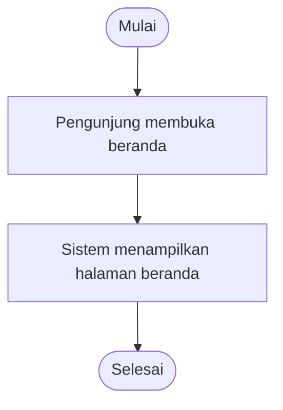

### UC-02 — Melihat informasi tentang situs

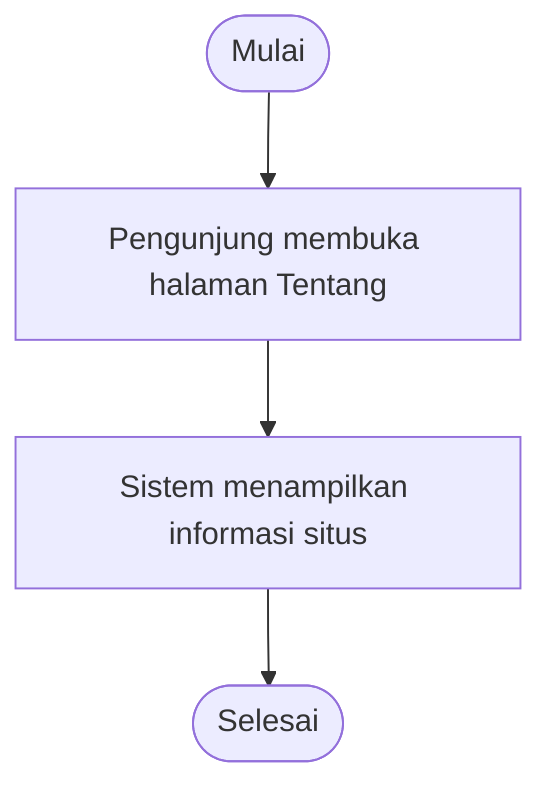

### UC-03 — Membuka halaman deteksi

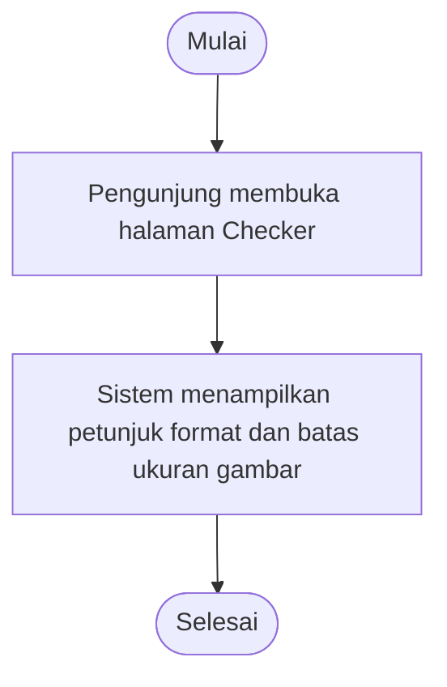

### UC-03A — Mencoba mengunggah gambar tanpa masuk

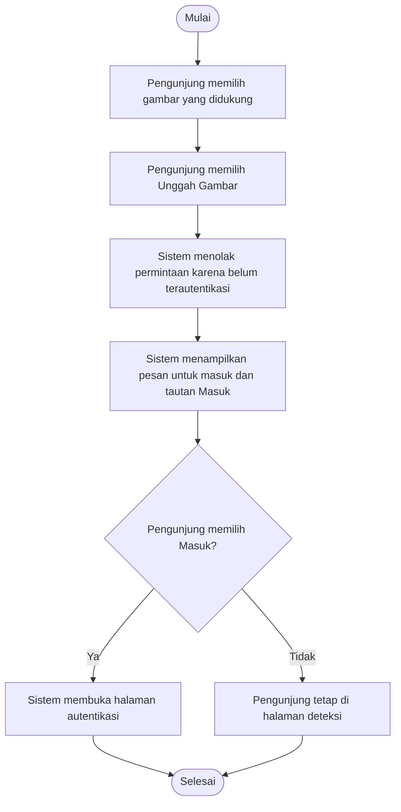

### UC-04 — Mendaftar akun

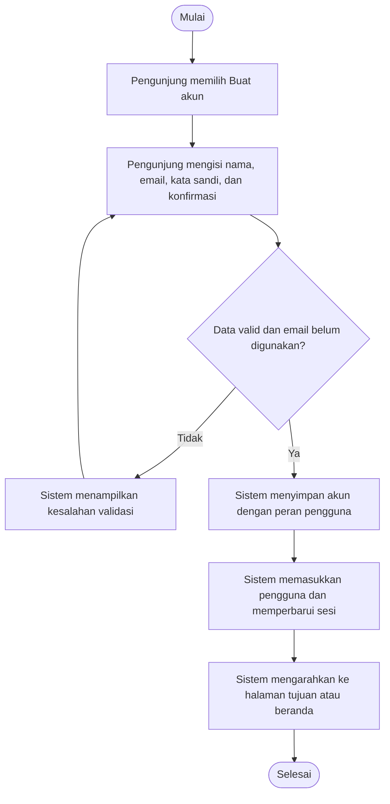

### UC-05 — Masuk ke akun

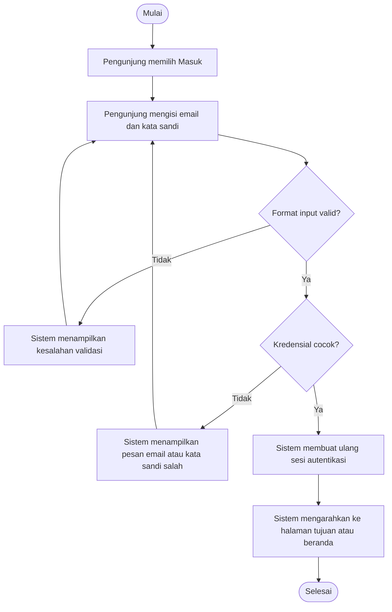

## Use case Pengguna terdaftar

### UC-06 — Menganalisis gambar

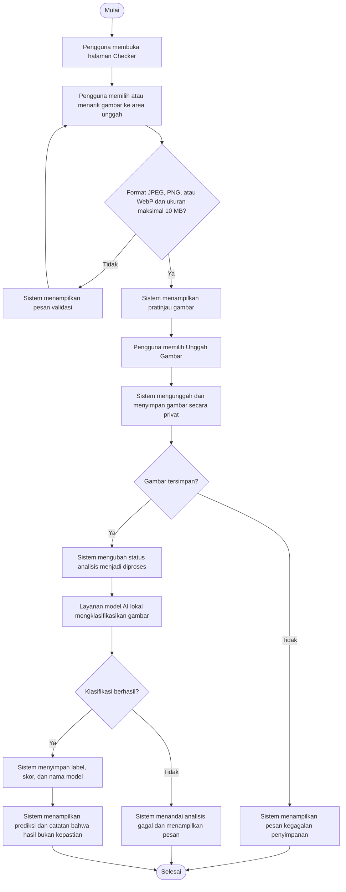

### UC-07 — Melihat, mencari, memfilter, dan mengurutkan riwayat

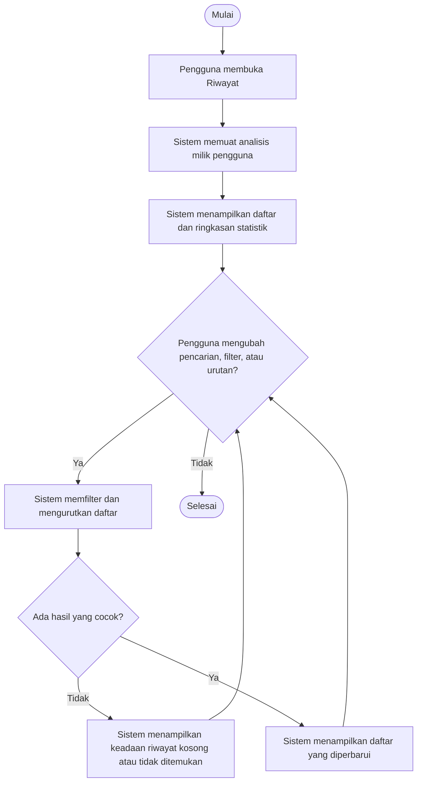

### UC-08 — Melihat detail analisis dan gambar

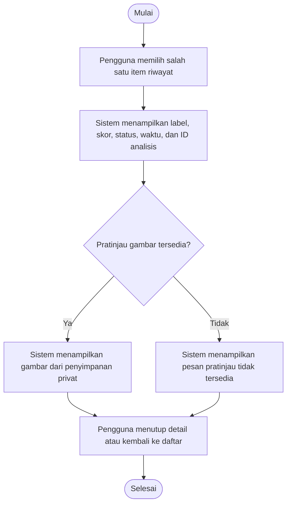

### UC-09 — Menyimpan laporan analisis

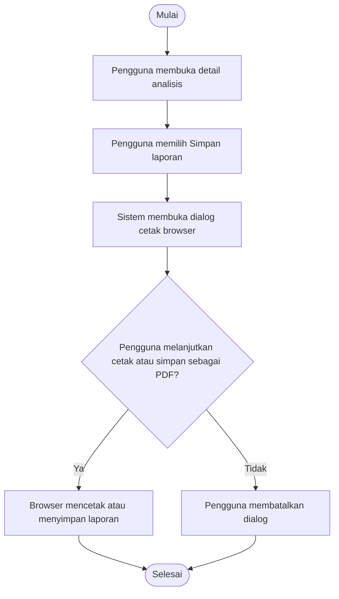

### UC-10 — Menghapus satu riwayat analisis

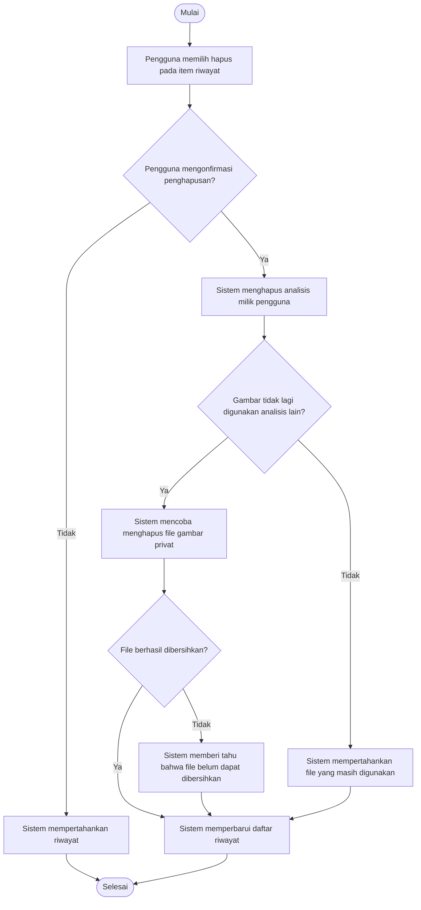

### UC-11 — Menghapus seluruh riwayat analisis

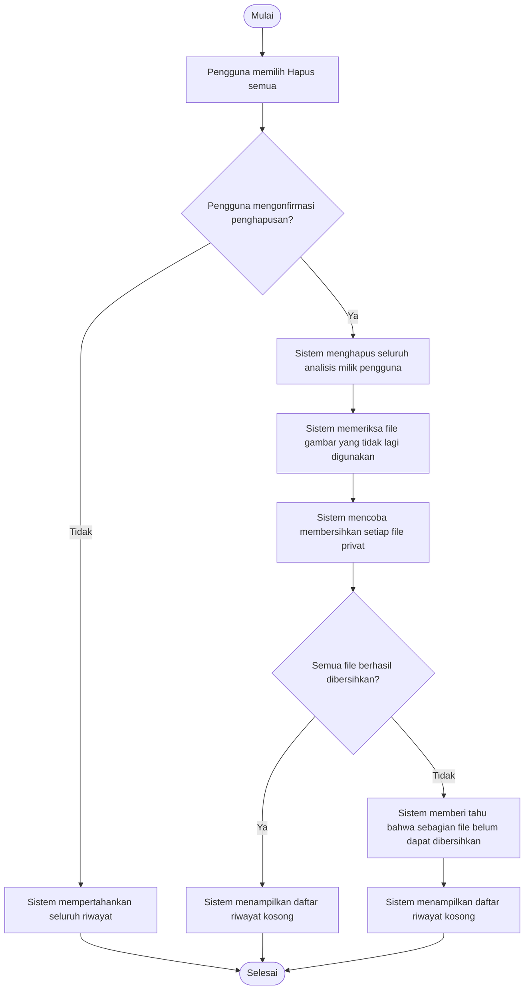

### UC-12 — Melihat dan memperbarui profil

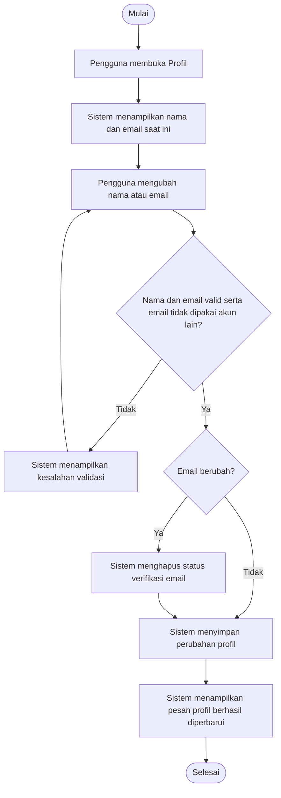

### UC-13 — Keluar dari akun

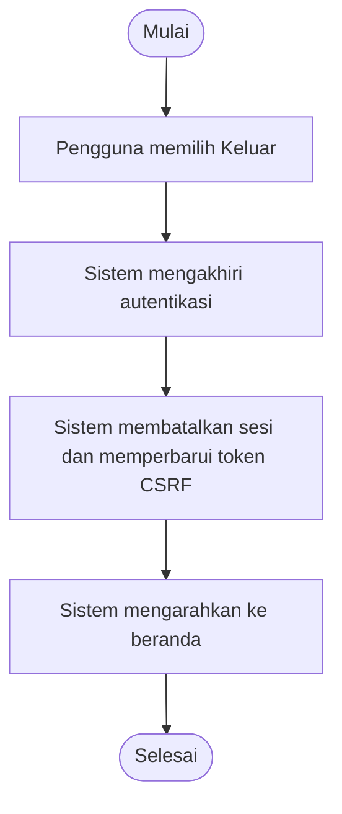

## Use case Admin

### UC-14 — Membuka panel admin

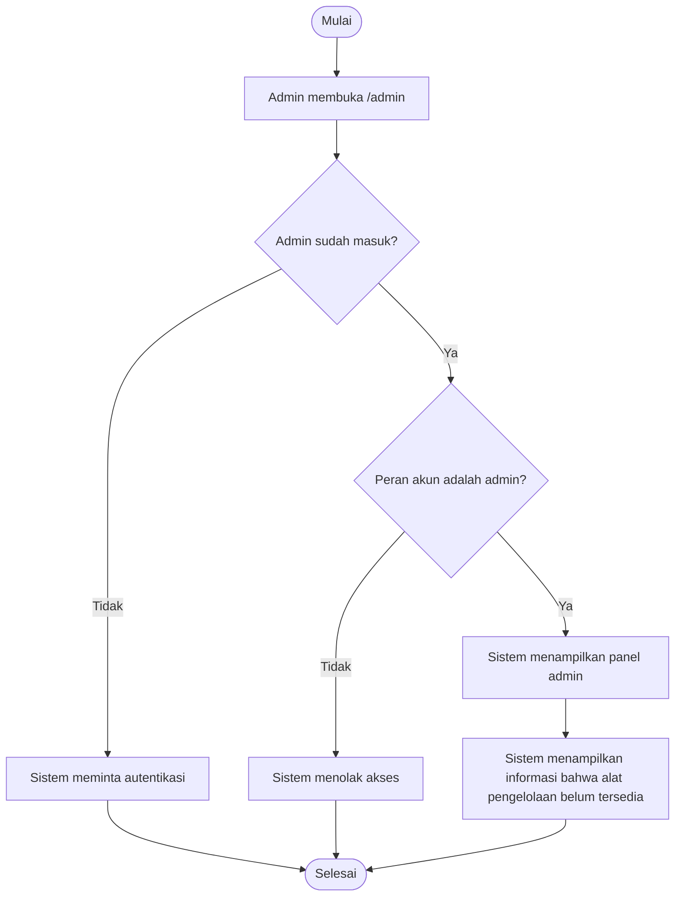

## Catatan implementasi

- Diagram ini mencakup use case yang terlihat pada rute, controller, dan halaman aplikasi saat ini; diagram tidak mengasumsikan fitur admin yang belum tersedia.
- Jika pengunjung mencoba mengunggah gambar, API mengembalikan status belum terautentikasi dan halaman menawarkan tautan masuk.
- Validasi masukan, kegagalan penyimpanan, dan kegagalan klasifikasi ditampilkan sebagai cabang alternatif pada diagram terkait.
- Rujukan implementasi: `routes/web.php`, `app/Http/Controllers/`, `resources/views/`, dan `resources/js/modules/`.
